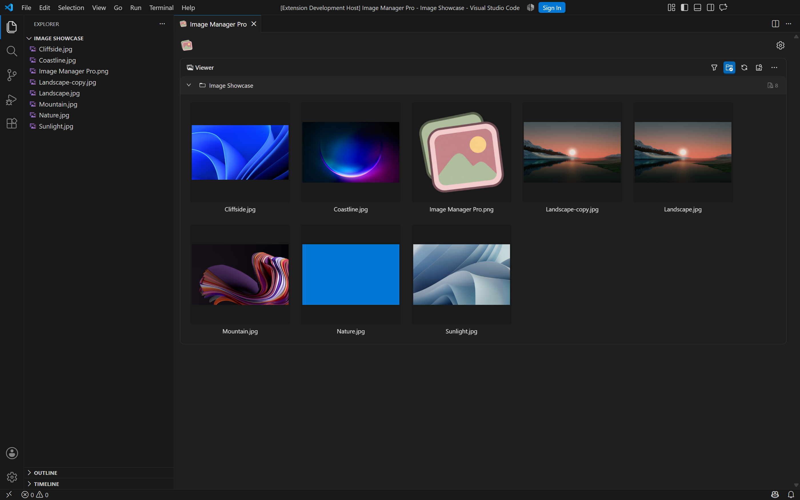
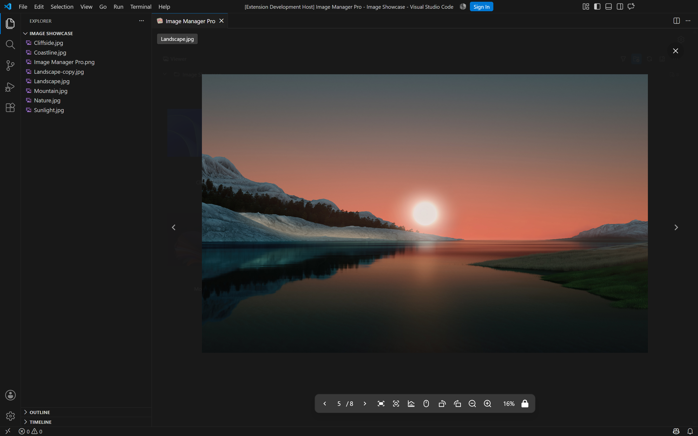
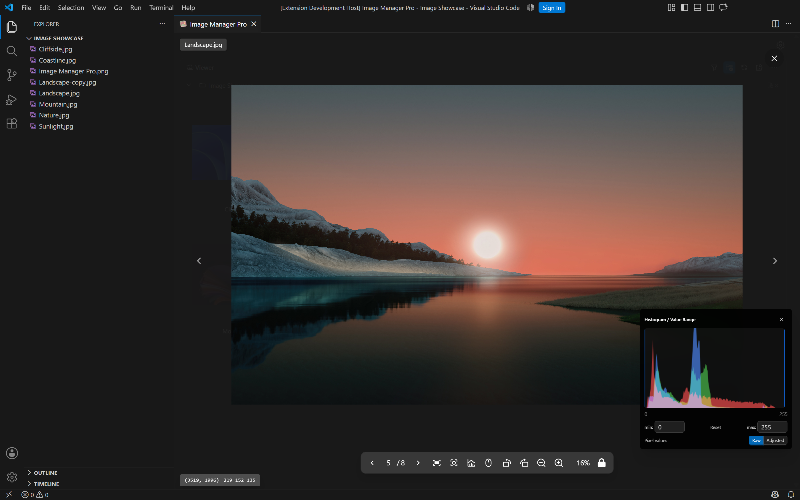
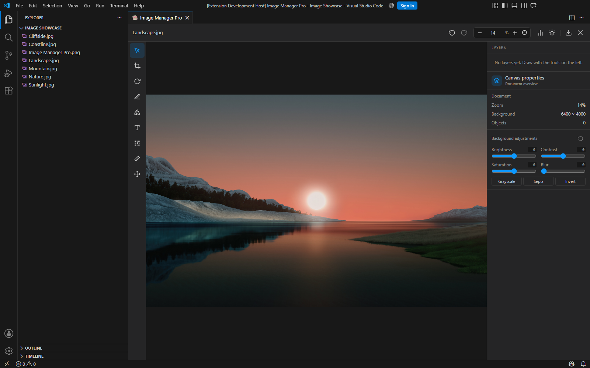
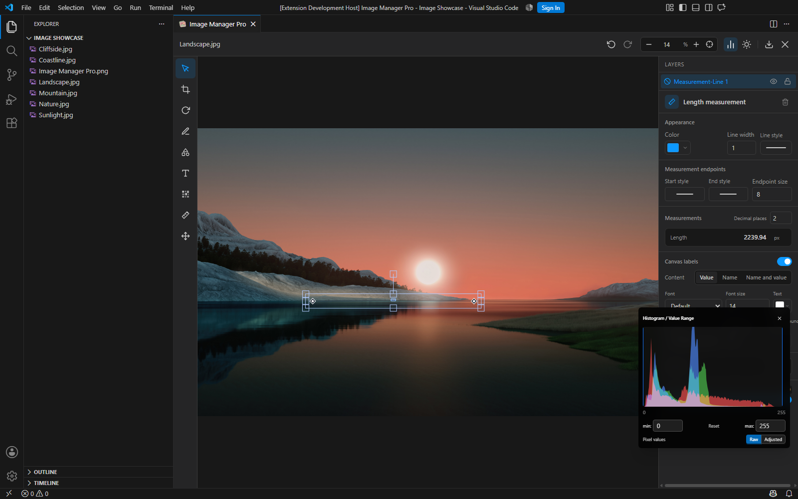

# Image Manager Pro

Browse, preview, edit and process workspace images directly in VS Code.

Inspect individual pixels, explore image thresholds with a histogram, measure image features, and make quick edits and annotations in one workspace.

## Browse Your Image Library

Browse folders, search filenames, filter and sort images, and select multiple files for batch operations.

## Inspect Image Details

Open large previews, zoom and pan, rotate and flip images, and inspect pixel values, colors, metadata and histograms.

### Read Individual Pixels

Read coordinates and RGBA values at the inspected position. At higher zoom levels, a pixel grid and numerical grayscale or RGB labels make individual pixels visible and easy to compare. Check small color differences, sharp edges, masks, and fine image details.

When adjusting the histogram range, switch between original and display-adjusted pixel values to inspect either the source data or the resulting display.

### Explore Histograms and Thresholds

View RGB or grayscale histograms, then drag the lower and upper bounds or enter precise numerical limits. Narrow the displayed intensity range to bring out faint structures and low-contrast details.

Set the two bounds to the same value for a binary threshold display. Inspect intensity boundaries interactively while keeping pixel readouts available.

## Edit and Annotate

Crop and rotate images, adjust brightness, contrast, saturation, blur, and grayscale, draw shapes and arrows, add text, or use the brush and mosaic tools. Manage objects and layers with visibility and locking controls, and refine changes with undo and redo.

### Measure Image Features

Annotate lengths and angles, and measure the perimeter or area of supported shapes. Lengths and perimeters are reported in pixels, areas in square pixels, and angles in degrees.

Customize decimal precision, line endpoints, angle arcs, label colors, and backgrounds. Display a measurement's name, value, or both, with separate label settings for perimeter and area. Keep measurements alongside the image while using the histogram and pixel inspection tools.

## Batch Tools

- Compress, resize and convert images.
- Rename multiple images.
- Compare images before and after processing.
- Find visually similar images using perceptual hashes and histograms.
- Configure NPY / Raw image presets alongside common image formats.

## Work with Image Data

Preview TIFF, NPY arrays, and raw binary image data alongside everyday image assets. Configure raw decoding presets for dimensions, data type, and related options, then use the same preview, pixel inspection, and histogram workflow to explore the result.

## Get Started

Open a workspace with images, then run **Image Manager Pro** from the Command Palette or open it from a folder's Explorer context menu.

Default shortcut: `Shift+Alt+J` on Windows / Linux; `Cmd+Alt+J` on macOS.

Settings include scan formats, exclusions, appearance and language. Light and dark themes are supported, with English, Simplified Chinese, Traditional Chinese, Japanese and German interfaces.

Select **English** or **Simplified Chinese** using
`image-manager.appearance.language` for complete editor translations, including
tools, properties, colors and measurement labels. Switching languages keeps the
current edits, custom names and existing text. Additional languages use English
fallbacks for the new editor labels.

Some image operations require sharp / libvips. When dependency installation is enabled, the extension can install this backend; the first installation may require network access. Available formats depend on the backend.

Project source and acknowledgments are available in the linked GitHub repository. License and third-party notices are included in the extension package.
