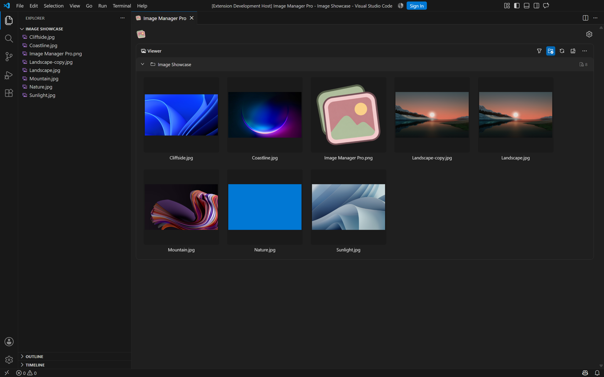
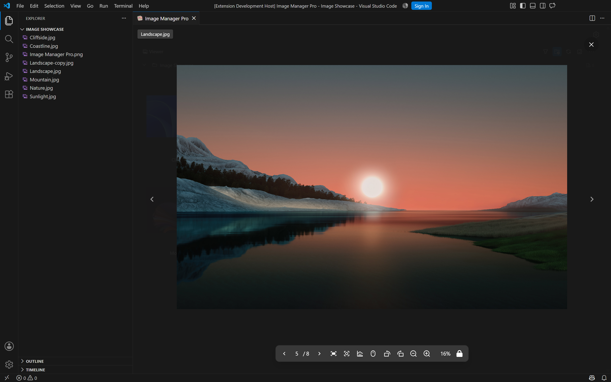
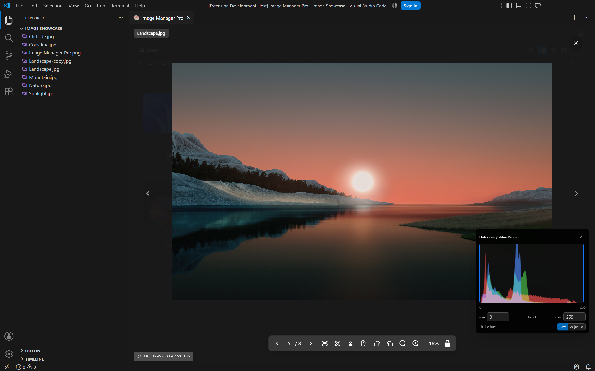
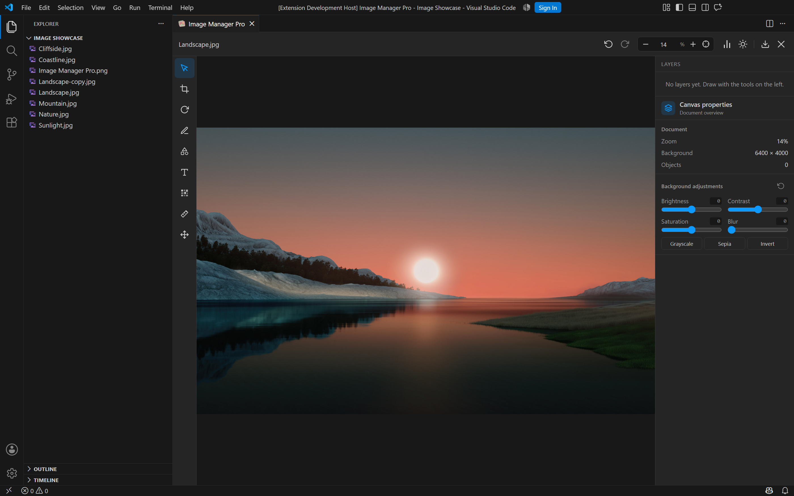
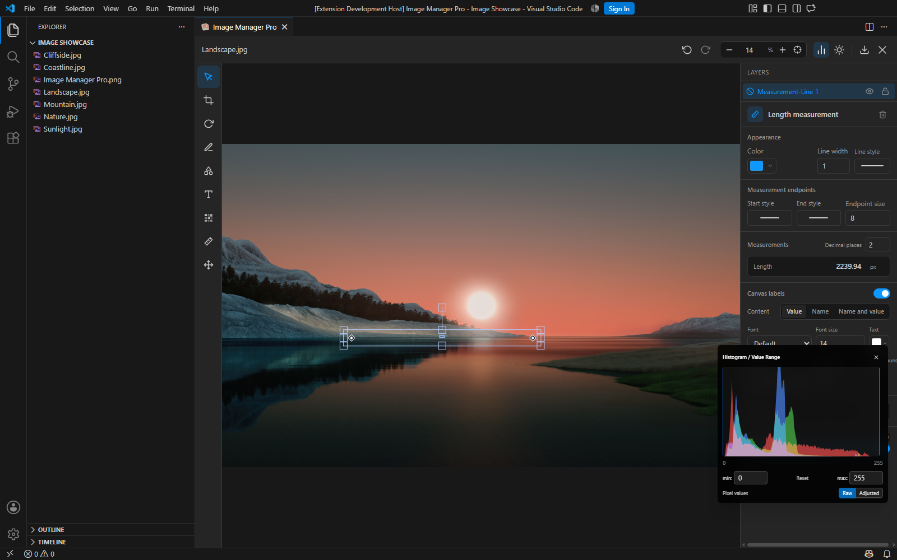
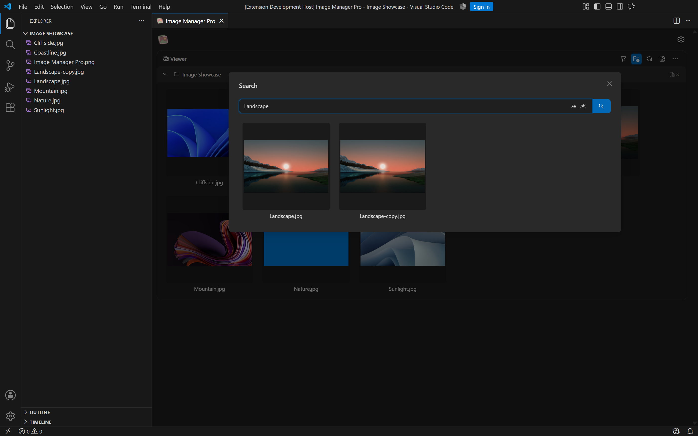
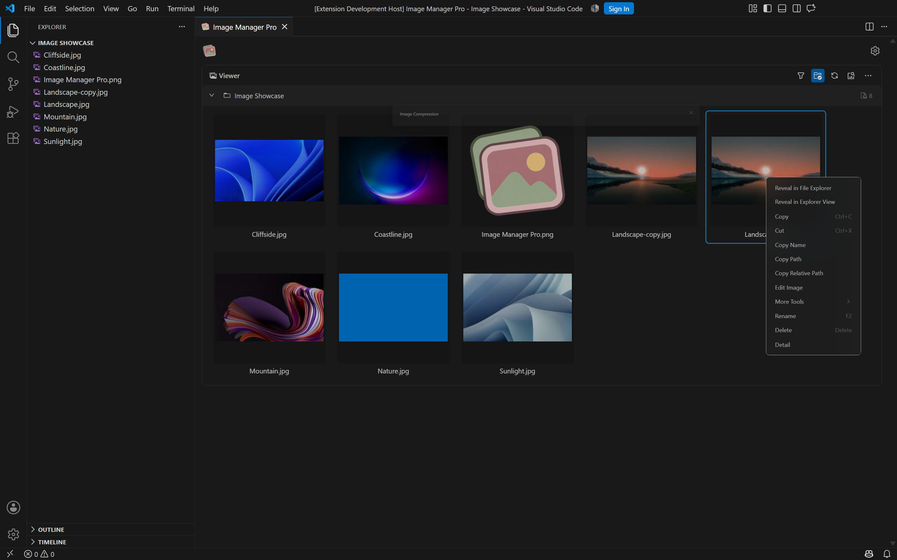
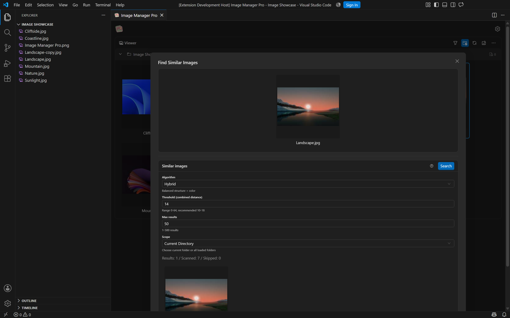

# Image Manager Pro

Browse, inspect, measure and edit workspace images directly in VS Code.

在 VS Code 中浏览图片、检查像素、测量、标注和编辑。

Image Manager Pro 不只是看图工具：你可以放大到 **5000%** 检查像素颜色值，用直方图调整显示阈值，绘制可再次编辑的图形和测量对象，还能批量压缩、转换格式和查找相似图片。

Image Manager Pro is designed for the moment when a normal file preview is no longer enough: read a pixel's RGBA value, tune a histogram threshold, measure a feature, keep annotations editable, or process a group of images without leaving the editor.

## 图片管理 · Workspace Gallery

直接浏览工作区中的图片，保留文件夹层级，支持搜索、筛选、排序和多选。选中图片后，通过右键菜单即可压缩、转换格式、重命名或查找相似图片。

Search filenames, browse folders, filter and sort the current view, select several images and open compression, conversion, rename or similarity tools from the same context menu.

## 图片预览 · Preview Controls

鼠标滚轮可以随时切换为**缩放图片**或**左右翻页**。预览时还可适应窗口、重新居中、旋转和翻转，或直接打开编辑器与直方图，无需反复退出当前图片。

- Switch the mouse wheel between zooming the current image and paging left or right through the folder.
- Use fit-to-window, reset-center, rotate, flip, zoom presets and direct percentage input.
- Keep side navigation visible while inspecting a single image.
- Open the editor, pixel inspector or histogram from the current preview.
- Preview common image formats together with TIFF, NPY and configurable raw binary data.

## 像素检查与阈值 · Pixels And Thresholds

放大到 **5000%** 查看像素网格及格内的灰度值或 RGB 数值，移动鼠标读取坐标与 RGBA 颜色值。通过直方图调整显示上下限，观察低对比度细节；将上下限设为同一数值，可预览二值化效果。

- Read pixel coordinates and RGBA values at the pointer.
- Use the 5000% preset to see a pixel grid with grayscale or RGB labels.
- Compare raw values with values after the current display adjustment.
- View RGB or grayscale histograms.
- Drag or enter lower and upper bounds to reveal low-contrast structures.
- Set both bounds to the same value for a binary threshold view.

## 图层与编辑 · Layers And Editing

裁剪、旋转、调整亮度和对比度，添加文字、形状、箭头、画笔或马赛克。**图形与文字作为独立对象保留在图层中**，之后仍可选中并移动、缩放、修改样式、隐藏或锁定，确认后再导出。

- Crop, rotate, adjust brightness, contrast, saturation, blur and grayscale.
- Add text, rectangles, circles, triangles, arrows, brush strokes and mosaic blocks.
- Keep every object in a layer list so it can be moved, restyled, hidden or locked later.
- Use undo and redo while refining an annotation.
- Export with a chosen format, scale, range and quality.

## 可再次编辑的测量 · Editable Measurements

直线、角度、多边形和椭圆测量创建后仍可修改。**拖动关键点即可调整测量位置**，也可移动文字标注，设置小数位数、颜色、字号和背景；周长与面积的标注可分别调整。

Line, angle, polygon and ellipse measurements are stored as objects rather than flattened pixels.

- Drag measurement points and angle arcs after creation.
- Choose decimal precision and show the name, value or both.
- Configure label color, font, background and opacity.
- Configure perimeter and area labels independently.
- Lock a finished measurement to protect it from accidental edits.

## 文件名搜索 · Filename Search

输入时即时筛选，支持区分大小写、全字匹配和搜索历史。找到图片后，可直接进入预览或编辑器。

Search as you type, use case-sensitive or whole-word matching, browse search history with the arrow keys, and open a match directly in preview or the editor.

## 批量压缩与转换 · Batch Processing

对多张图片或整个目录统一设置格式、质量、缩放比例和输出位置，可保留原图或跳过已压缩文件。可用格式取决于已安装的图像处理组件。

- Configure quality, compression level, scale, format, output path and original-file handling.
- Batch process selected images or a directory.
- Support PNG, JPG, JPEG, WebP, GIF, TIFF, AVIF and HEIF when the installed backend provides them.
- Skip files that are already compressed.

## 相似图片查找 · Similarity Search

在当前目录或所有已加载目录中查找相似图片，支持多种算法、自定义阈值和结果数量，便于对比重复图与不同版本。

- Compare the current directory or all loaded directories.
- Choose hybrid, pHash, dHash, aHash or histogram algorithms.
- Tune the threshold and maximum result count.
- Use stricter thresholds for precision or higher thresholds to find more variants.

## 格式、主题与语言 · Formats, Themes And Languages

支持 TIFF、NPY 数组和可配置的原始二进制图像数据。设置 `image-manager.appearance.language` 即可切换简体中文或 English，当前编辑内容会保留；界面同时适配浅色和深色主题。

Preview TIFF, NPY arrays and configurable raw binary data with the same pixel and histogram workflow. Choose **English** or **Simplified Chinese** with `image-manager.appearance.language`; editor labels update without recreating the canvas or losing custom names and existing text. Traditional Chinese, Japanese and German remain available for the main interface. Light and dark VS Code themes are supported.

## 开始使用 · Get Started

打开包含图片的工作区，从命令面板或文件夹右键菜单运行 **Image Manager Pro**。默认快捷键：Windows/Linux 为 `Shift+Alt+J`，macOS 为 `Cmd+Alt+J`。

Open a workspace containing images, then run **Image Manager Pro** from the Command Palette or a folder's Explorer context menu.

Default shortcut: `Shift+Alt+J` on Windows/Linux and `Cmd+Alt+J` on macOS.

Some operations use Sharp and platform-specific native dependencies. The extension can install them when enabled in settings; supported formats depend on the available codecs.

Project source, MIT licensing and upstream acknowledgments are available in the linked GitHub repository.
