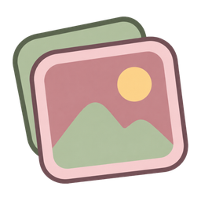
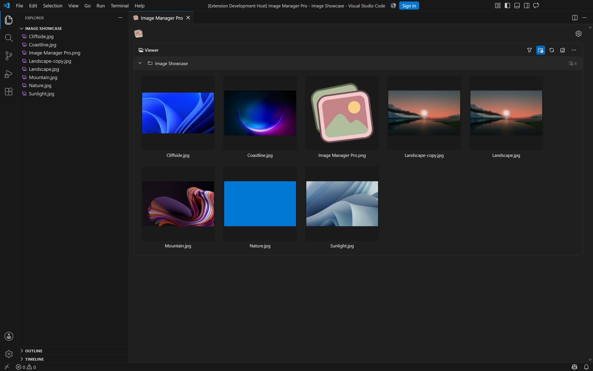
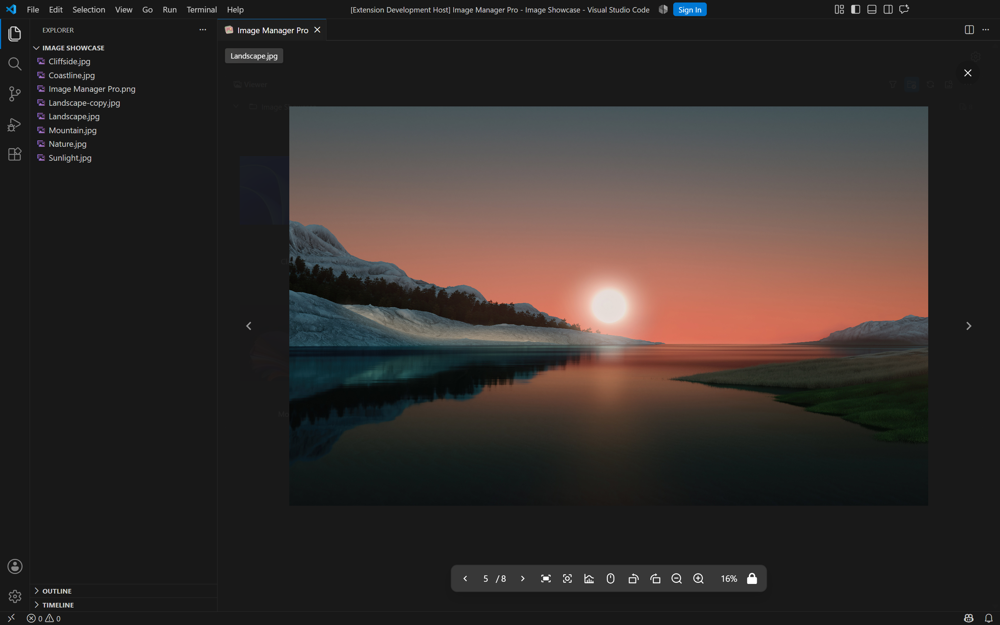
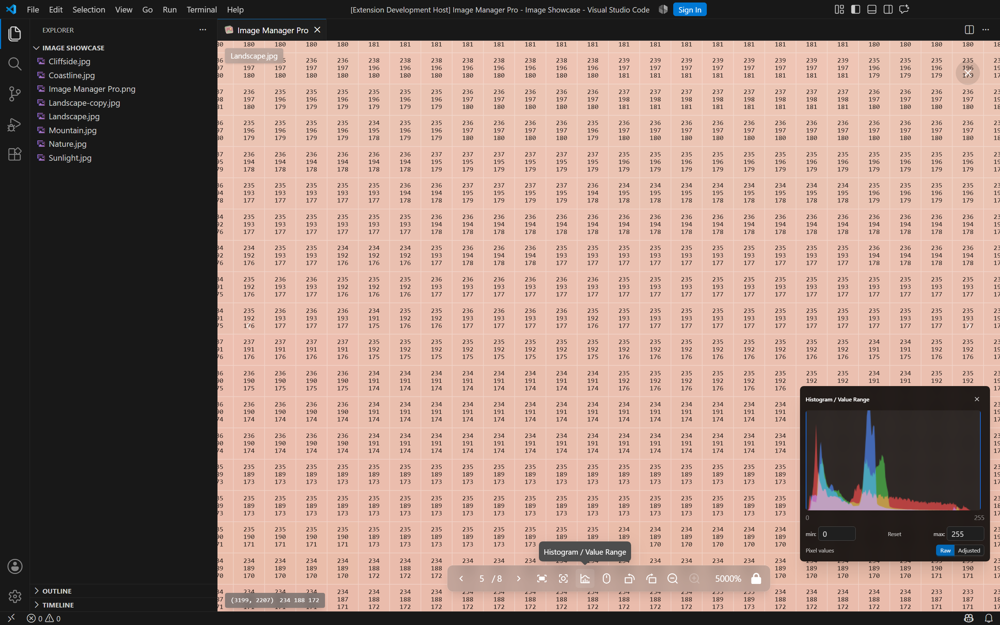
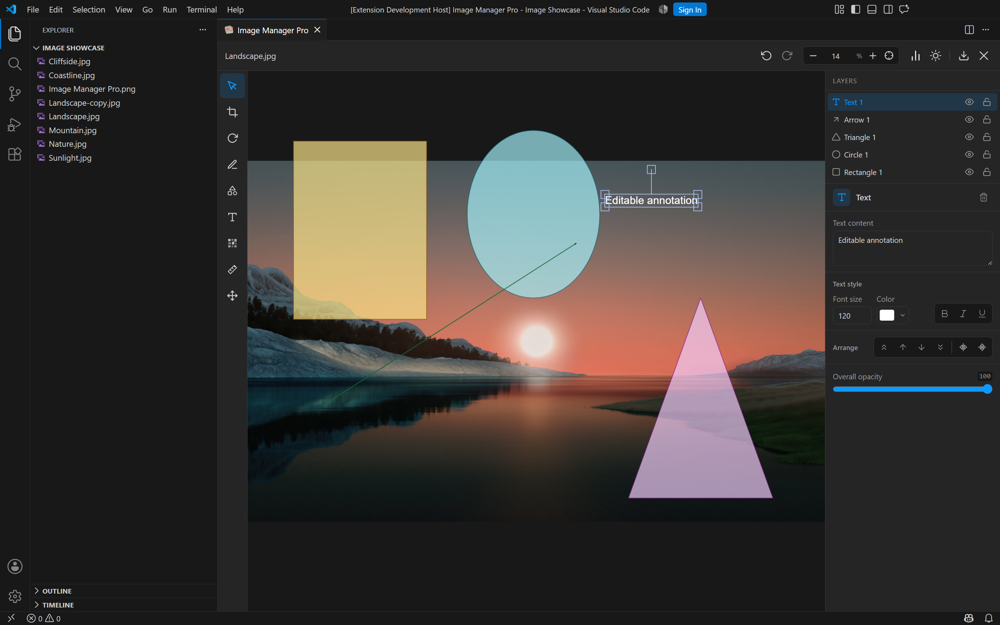
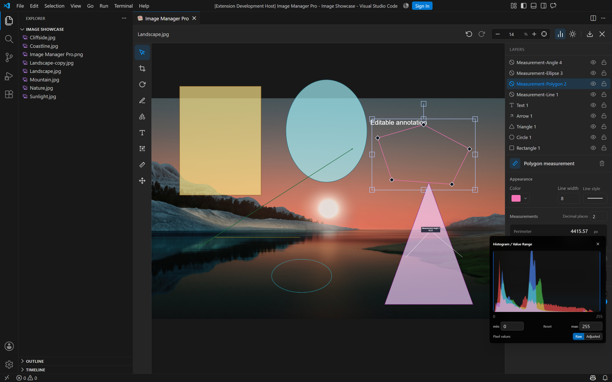
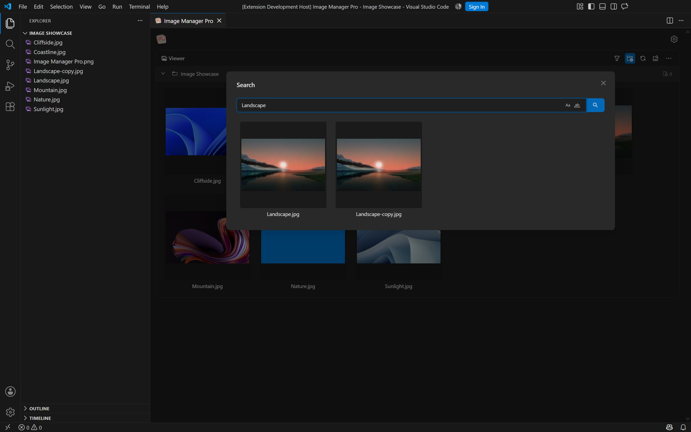
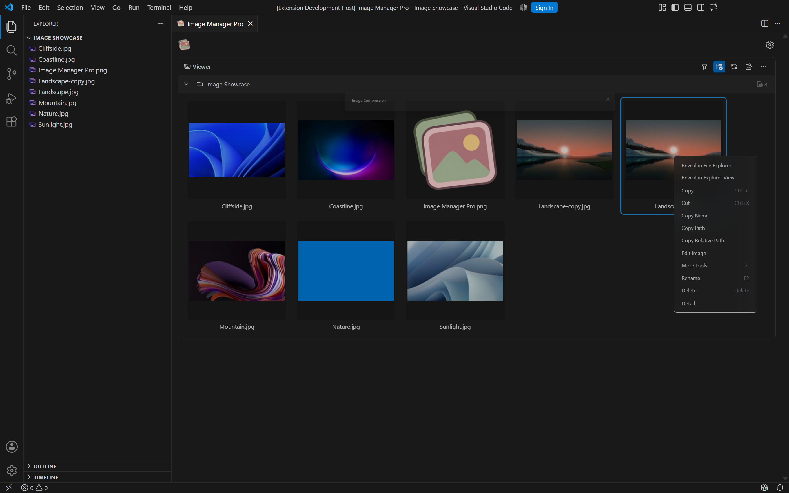
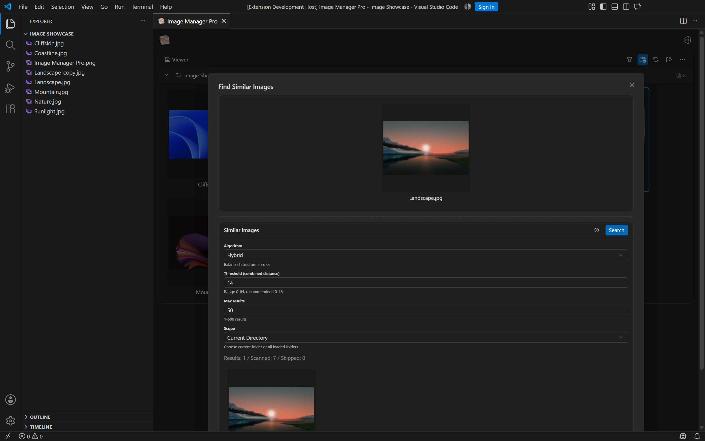

  

<h1 align="center">Image Manager Pro</h1>

A fast image workspace for browsing, inspecting, measuring and editing inside VS Code.

[简体中文](./README.zh.md)

Image Manager Pro keeps the image workflow next to your code. Browse a folder, search by filename, inspect a pixel, tune a threshold, measure a feature, or create an editable annotation without leaving VS Code.

## Start With Your Image Library

The gallery is built for real folders, not one-off uploads. Expand directories, search filenames, filter and sort the current view, select several images, and open actions from the same context menu.

Small details make repeated work faster:

- Search by filename with case-sensitive and whole-word modes.
- Keep the folder hierarchy visible while browsing a large workspace.
- Use the same image selection for compression, conversion, rename and similarity search.
- Open an image in the VS Code or system explorer, copy its name or path, or reveal it in the viewer.
- The gallery supports dark and light VS Code themes.

## Preview Images The Way You Work

Open a large preview and decide what the mouse wheel should do. The toolbar switches between wheel zoom and wheel paging, so the same gesture can either inspect detail or move through a sequence of images.

Useful preview controls include:

- Zoom with the wheel, toolbar buttons or a percentage input.
- Switch the wheel to left/right image paging when reviewing a folder.
- Fit the image to the window, reset the center, rotate, flip and move through the preview.
- Keep the side navigation available while inspecting a single image.
- Open the editor or histogram without losing the current image.
- Preview common formats together with TIFF, NPY and configurable raw binary data.

## Read The Image, Pixel By Pixel

At high zoom levels, the preview becomes a practical pixel inspection tool. Move over the image to read coordinates and color values, then compare source data with the adjusted display.

- Use the 5000% preset to display an enlarged pixel grid with grayscale or RGB values on individual pixels.
- Read the current pixel coordinate and RGBA value directly from the preview.
- Switch between raw values and values after the current display adjustment.
- Inspect RGB or grayscale histograms while keeping the image visible.
- Drag or enter lower and upper histogram bounds to reveal faint structures.
- Set both bounds to the same value for a binary threshold view.

This is useful for checking edges, masks, low-contrast regions, screenshots, icons and scientific images. Threshold adjustment is visual and immediate; it does not pretend to be an automatic segmentation result.

## Edit With Objects You Can Revisit

The editor is designed for changes that may need another pass. Crop, rotate, adjust brightness or contrast, add text, draw rectangles, circles, triangles and arrows, brush, mosaic, and export the result from one workspace.

- Every drawn shape, arrow, text object and measurement stays in the layer list.
- Select an object later to move, resize, restyle, hide or lock it.
- Keep multiple annotations independent instead of flattening them into pixels.
- Use undo and redo while experimenting with an edit.
- Change line width, dash style, colors, text and alignment from the properties panel.
- Export the edited image with a chosen format, scale, range and quality.

## Measure, Then Adjust The Measurement

Length, angle, polygon perimeter and ellipse or polygon area measurements are stored as editable objects. A measurement is not a screenshot pasted over the image: select it again, drag its points, move its label, or change the way it is displayed.

- Drag measurement points and angle arcs after creation.
- Report lengths and perimeters in pixels, areas in square pixels and angles in degrees.
- Choose the number of decimal places.
- Show the measurement name, value or both.
- Configure label color, font, background and opacity.
- Adjust perimeter and area labels separately.
- Lock a finished measurement when it should stay in place.

## Search Large Workspaces Quickly

The filename search dialog is useful when the folder is already bigger than your screen. It searches the loaded workspace and keeps the result as a small, focused image set.

- Search as you type and jump straight to the matching image.
- Use case-sensitive or whole-word matching when filenames are systematic.
- Open the result directly in preview, the editor or the file context menu.
- Keep search history available with the arrow keys.

## Compress And Convert In Batches

Compression is configured in one place for the selected images. Choose a target format, quality, scale, output folder and whether to keep originals.

- Compress PNG, JPG, JPEG, WebP, GIF, TIFF, AVIF and HEIF where the installed backend supports them.
- Set image quality, compression level and output scale.
- Skip files that are already compressed.
- Keep the original files or write results to a tool folder.
- Run the same operation on a selection or a directory.

## Find Visual Duplicates

Similarity search compares images with configurable algorithms and thresholds, then presents the closest matches in the same dialog.

- Compare images in the current directory or across loaded directories.
- Choose a hybrid, pHash, dHash, aHash or histogram-based method.
- Adjust the threshold and maximum result count.
- Use stricter values for fewer false positives or higher values for more variants.
- Open a matched image in the same preview and editing workflow.

## Work With More Than JPG And PNG

Preview TIFF, NPY arrays and raw binary image data with configurable dimensions and data types. The same pixel, histogram and threshold tools remain available so the format does not interrupt the inspection workflow.

## Language And Theme

Choose **English** or **Simplified Chinese** with `image-manager.appearance.language`. Editor tools, properties, colors and measurement labels update immediately while keeping the current canvas, layers, custom names and existing text. Traditional Chinese, Japanese and German remain available for the main interface, with English fallback for newer editor labels.

Light and dark VS Code themes are supported.

## Get Started

Open a workspace containing images, then run **Image Manager Pro** from the Command Palette or the folder context menu.

Default shortcut: `Shift+Alt+J` on Windows/Linux and `Cmd+Alt+J` on macOS.

Some image operations use Sharp and platform-specific native dependencies. The extension can install these when enabled in settings; supported formats depend on the available codecs.

## Acknowledgments

**This project is based on [Image Manager](https://github.com/hemengke1997/vscode-image-manager) by hemengke1997 (Minko).** Its source code and design form the foundation of this extension. Special thanks to the original author and contributors for making this work possible.

The editor incorporates adapted code from [fabric-photo](https://github.com/ximing/fabric-photo) by ximing. We also retain Image Manager's original acknowledgments to [vscode-image-viewer](https://github.com/ZhangJian1713/vscode-image-viewer) and [vscode-svgo](https://github.com/1000ch/vscode-svgo).

## License

Project code is available under the [MIT License](./LICENSE). Third-party components retain their own licenses; see [Third-Party Notices](./THIRD_PARTY_NOTICES.md).
