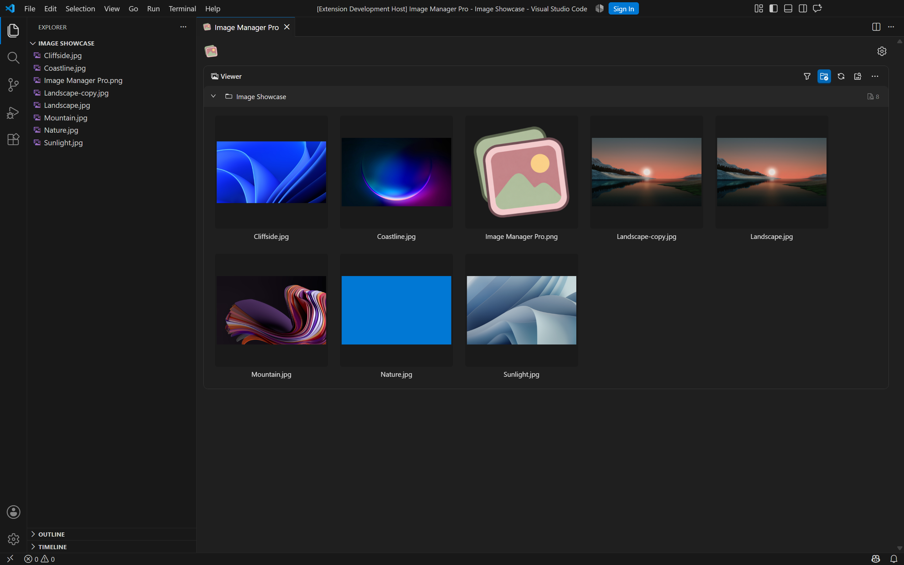
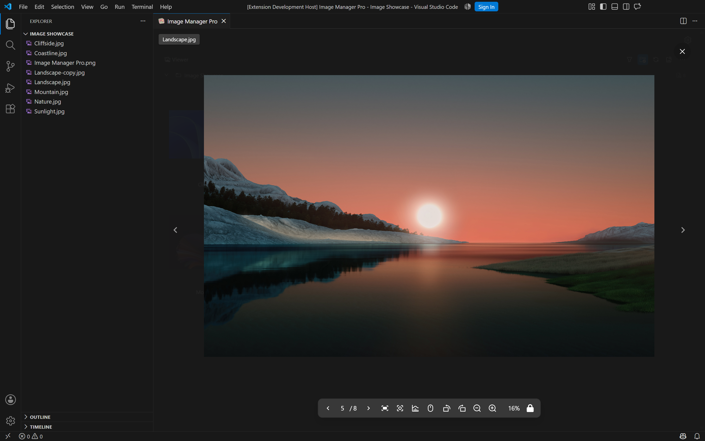
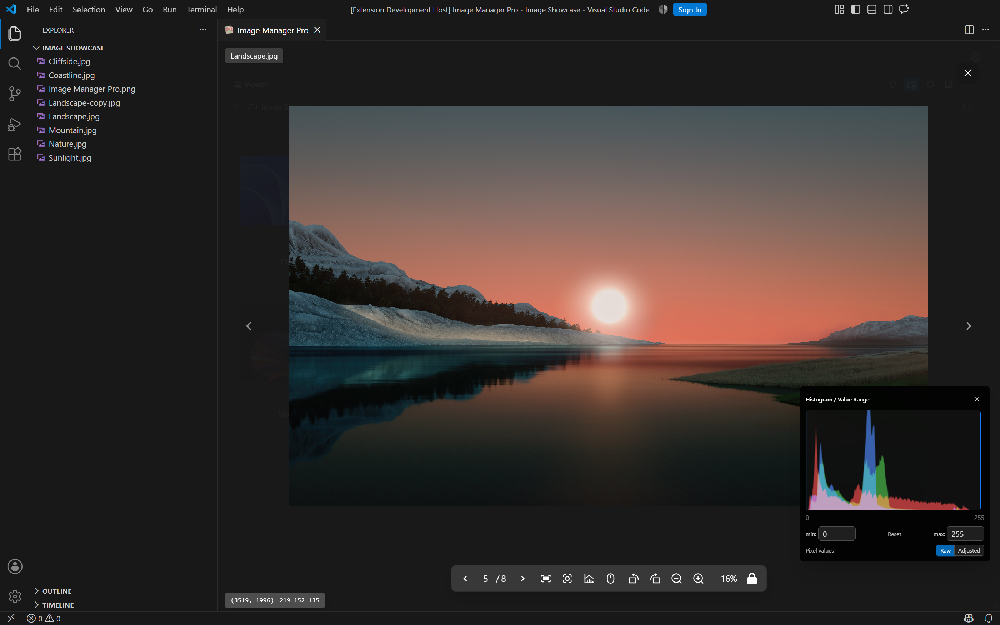
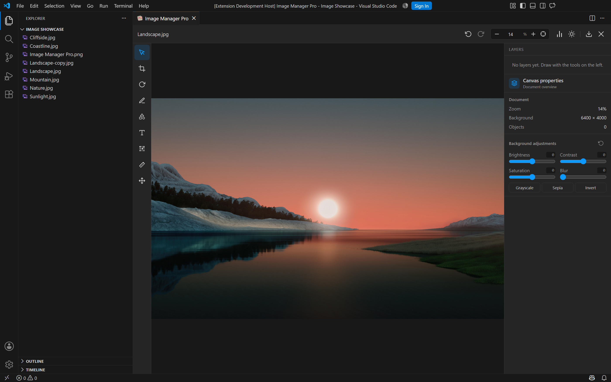
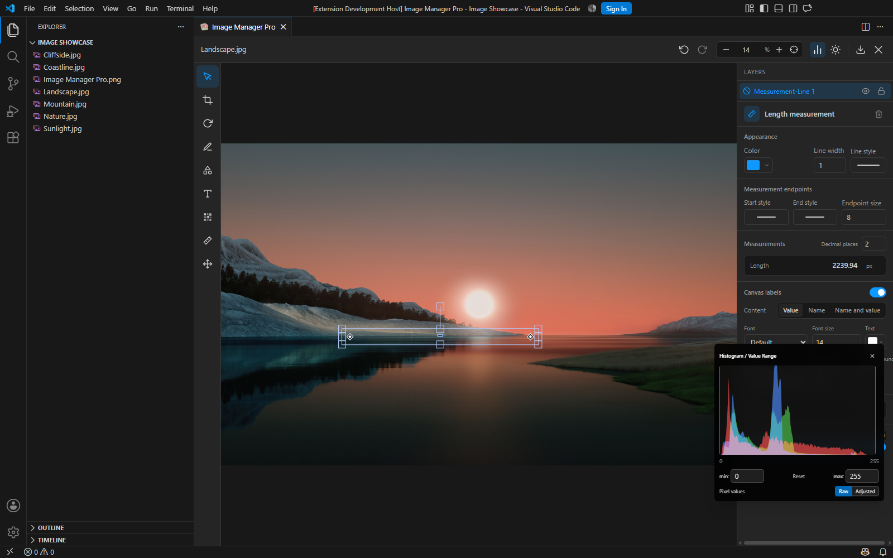
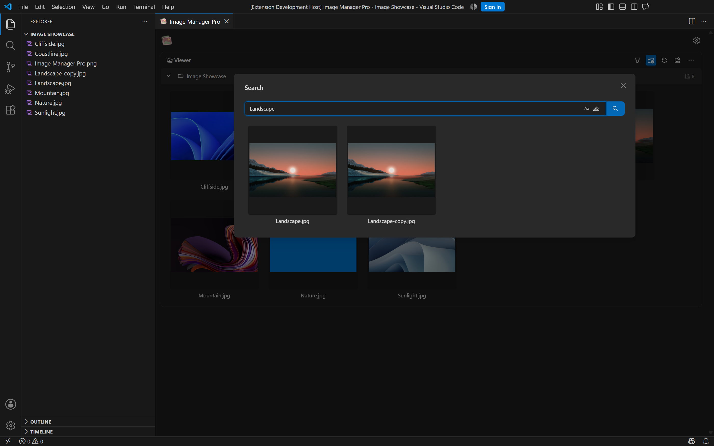
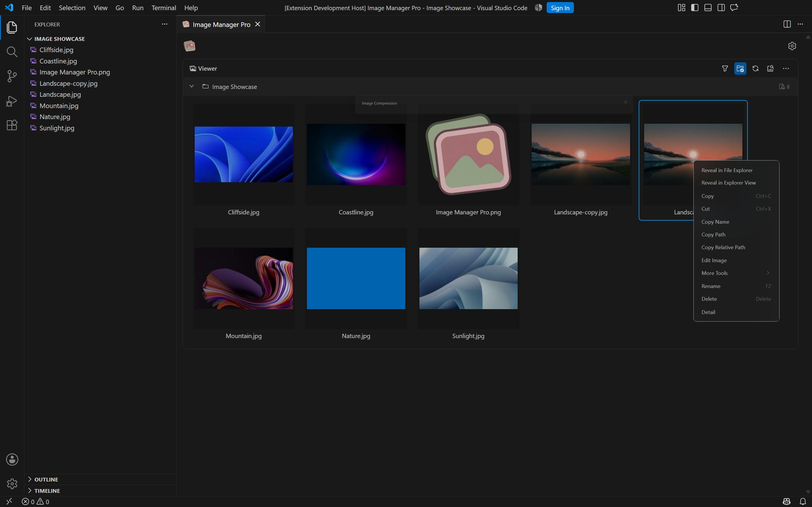
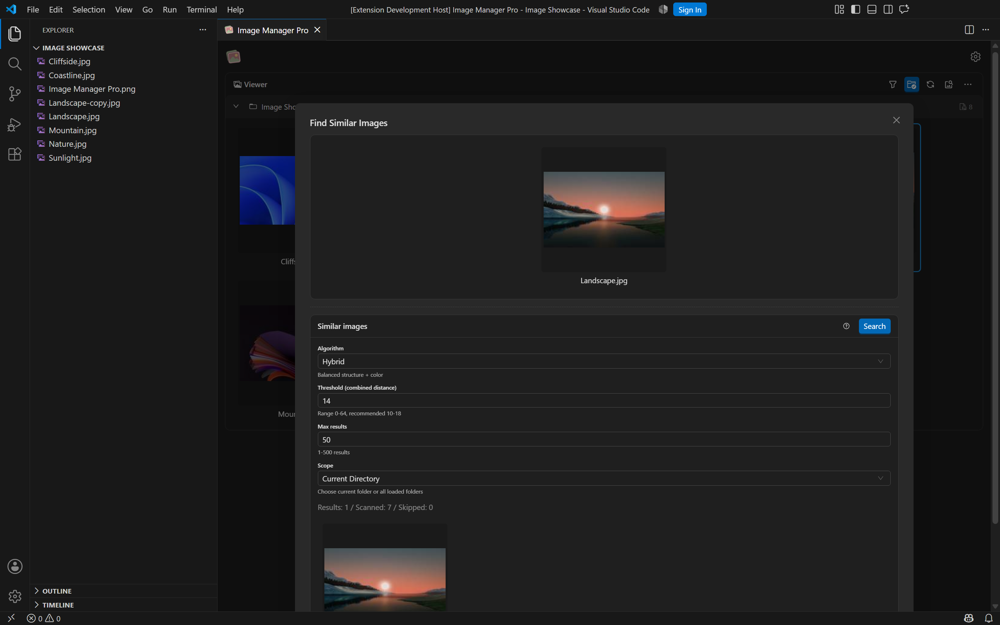

  

<h1 align="center">Image Manager Pro</h1>

A fast image workspace for browsing, inspecting, measuring and editing inside VS Code.

在 VS Code 中浏览图片、检查像素、测量、标注和编辑。

[完整中文文档](./README.zh.md)

Image Manager Pro 让你在 VS Code 中完成常用的图片处理：浏览工作区、搜索文件名、放大查看像素颜色值、用直方图调整显示阈值，以及测量、标注和批量压缩。绘制的图形、文字和测量对象保留在图层中，创建后仍可选中修改。

Image Manager Pro keeps the image workflow next to your code. Browse a folder, search by filename, inspect a pixel, tune a threshold, measure a feature, or create an editable annotation without leaving VS Code.

## 图片管理 · Workspace Gallery

直接浏览工作区中的图片，保留文件夹层级。支持按文件名搜索、筛选、排序和多选，再通过右键菜单进行压缩、格式转换、重命名或查找相似图片。

The gallery is built for real folders, not one-off uploads. Expand directories, search filenames, filter and sort the current view, select several images, and open actions from the same context menu.

Small details make repeated work faster:

- Search by filename with case-sensitive and whole-word modes.
- Keep the folder hierarchy visible while browsing a large workspace.
- Use the same image selection for compression, conversion, rename and similarity search.
- Open an image in the VS Code or system explorer, copy its name or path, or reveal it in the viewer.
- The gallery supports dark and light VS Code themes.

## 图片预览 · Preview Controls

鼠标滚轮可以随时切换为**缩放图片**或**左右翻页**：检查细节时放大，连续看图时翻页。还可一键适应窗口、重新居中、旋转和翻转，并从当前预览直接进入编辑器或打开直方图。

Open a large preview and decide what the mouse wheel should do. The toolbar switches between wheel zoom and wheel paging, so the same gesture can either inspect detail or move through a sequence of images.

Useful preview controls include:

- Zoom with the wheel, toolbar buttons or a percentage input.
- Switch the wheel to left/right image paging when reviewing a folder.
- Fit the image to the window, reset the center, rotate, flip and move through the preview.
- Keep the side navigation available while inspecting a single image.
- Open the editor or histogram without losing the current image.
- Preview common formats together with TIFF, NPY and configurable raw binary data.

## 像素检查与阈值 · Pixels And Thresholds

放大到 **5000%** 后，可以看到像素网格及格内的灰度值或 RGB 数值，移动鼠标可读取像素坐标与 RGBA 颜色值。直方图支持调整显示上下限，便于观察低对比度细节；将上下限设为同一数值，可预览二值化效果。

At high zoom levels, the preview becomes a practical pixel inspection tool. Move over the image to read coordinates and color values, then compare source data with the adjusted display.

- Use the 5000% preset to display an enlarged pixel grid with grayscale or RGB values on individual pixels.
- Read the current pixel coordinate and RGBA value directly from the preview.
- Switch between raw values and values after the current display adjustment.
- Inspect RGB or grayscale histograms while keeping the image visible.
- Drag or enter lower and upper histogram bounds to reveal faint structures.
- Set both bounds to the same value for a binary threshold view.

This is useful for checking edges, masks, low-contrast regions, screenshots, icons and scientific images. Threshold adjustment is visual and immediate; it does not pretend to be an automatic segmentation result.

## 图层与编辑 · Layers And Editing

支持裁剪、旋转、亮度和对比度调整，以及文字、形状、箭头、画笔和马赛克。**图形和文字作为独立对象保留在图层中**，之后还可重新选中，移动、缩放、修改样式、隐藏或锁定，配合撤销与重做反复调整，确认后再导出。

The editor is designed for changes that may need another pass. Crop, rotate, adjust brightness or contrast, add text, draw rectangles, circles, triangles and arrows, brush, mosaic, and export the result from one workspace.

- Every drawn shape, arrow, text object and measurement stays in the layer list.
- Select an object later to move, resize, restyle, hide or lock it.
- Keep multiple annotations independent instead of flattening them into pixels.
- Use undo and redo while experimenting with an edit.
- Change line width, dash style, colors, text and alignment from the properties panel.
- Export the edited image with a chosen format, scale, range and quality.

## 可再次编辑的测量 · Editable Measurements

支持直线、角度、多边形和椭圆测量。**测量完成后仍可拖动关键点修改位置**，不必重新绘制；也可移动文字标注，调整小数位数、颜色和字号。多边形与椭圆的周长、面积标注可以分别设置。

Length, angle, polygon perimeter and ellipse or polygon area measurements are stored as editable objects. A measurement is not a screenshot pasted over the image: select it again, drag its points, move its label, or change the way it is displayed.

- Drag measurement points and angle arcs after creation.
- Report lengths and perimeters in pixels, areas in square pixels and angles in degrees.
- Choose the number of decimal places.
- Show the measurement name, value or both.
- Configure label color, font, background and opacity.
- Adjust perimeter and area labels separately.
- Lock a finished measurement when it should stay in place.

## 文件名搜索 · Filename Search

输入时即时筛选图片，支持区分大小写和全字匹配，可用方向键查看搜索历史。找到图片后，直接打开预览或编辑器。

The filename search dialog is useful when the folder is already bigger than your screen. It searches the loaded workspace and keeps the result as a small, focused image set.

- Search as you type and jump straight to the matching image.
- Use case-sensitive or whole-word matching when filenames are systematic.
- Open the result directly in preview, the editor or the file context menu.
- Keep search history available with the arrow keys.

## 批量压缩与转换 · Batch Processing

对多张选中的图片或整个目录统一设置格式、质量、缩放比例和输出位置，可选择保留原图或跳过已压缩的文件。可用格式取决于已安装的图像处理组件。

Compression is configured in one place for the selected images. Choose a target format, quality, scale, output folder and whether to keep originals.

- Compress PNG, JPG, JPEG, WebP, GIF, TIFF, AVIF and HEIF where the installed backend supports them.
- Set image quality, compression level and output scale.
- Skip files that are already compressed.
- Keep the original files or write results to a tool folder.
- Run the same operation on a selection or a directory.

## 相似图片查找 · Similarity Search

在当前目录或所有已加载目录中比较图片，支持多种相似度算法，并可调整阈值和结果数量，方便查找重复图或内容相近的不同版本。

Similarity search compares images with configurable algorithms and thresholds, then presents the closest matches in the same dialog.

- Compare images in the current directory or across loaded directories.
- Choose a hybrid, pHash, dHash, aHash or histogram-based method.
- Adjust the threshold and maximum result count.
- Use stricter values for fewer false positives or higher values for more variants.
- Open a matched image in the same preview and editing workflow.

## 更多图像格式 · More Image Formats

除常见图片外，还能预览 TIFF、NPY 数组和原始二进制图像数据，并配置尺寸和数据类型；像素检查、直方图和阈值工具同样可用。

Preview TIFF, NPY arrays and raw binary image data with configurable dimensions and data types. The same pixel, histogram and threshold tools remain available so the format does not interrupt the inspection workflow.

## 语言与主题 · Language And Theme

在设置项 `image-manager.appearance.language` 中选择简体中文或 English，编辑器文字会即时切换，当前画布、图层、自定义名称和已有文字都会保留。界面支持 VS Code 的浅色与深色主题。

Choose **English** or **Simplified Chinese** with `image-manager.appearance.language`. Editor tools, properties, colors and measurement labels update immediately while keeping the current canvas, layers, custom names and existing text. Traditional Chinese, Japanese and German remain available for the main interface, with English fallback for newer editor labels.

Light and dark VS Code themes are supported.

## 开始使用 · Get Started

打开包含图片的工作区，从命令面板或文件夹右键菜单运行 **Image Manager Pro**。默认快捷键：Windows/Linux 为 `Shift+Alt+J`，macOS 为 `Cmd+Alt+J`。

Open a workspace containing images, then run **Image Manager Pro** from the Command Palette or the folder context menu.

Default shortcut: `Shift+Alt+J` on Windows/Linux and `Cmd+Alt+J` on macOS.

Some image operations use Sharp and platform-specific native dependencies. The extension can install these when enabled in settings; supported formats depend on the available codecs.

## Acknowledgments

**This project is based on [Image Manager](https://github.com/hemengke1997/vscode-image-manager) by hemengke1997 (Minko).** Its source code and design form the foundation of this extension. Special thanks to the original author and contributors for making this work possible.

The editor incorporates adapted code from [fabric-photo](https://github.com/ximing/fabric-photo) by ximing. We also retain Image Manager's original acknowledgments to [vscode-image-viewer](https://github.com/ZhangJian1713/vscode-image-viewer) and [vscode-svgo](https://github.com/1000ch/vscode-svgo).

## License

Project code is available under the [MIT License](./LICENSE). Third-party components retain their own licenses; see [Third-Party Notices](./THIRD_PARTY_NOTICES.md).
