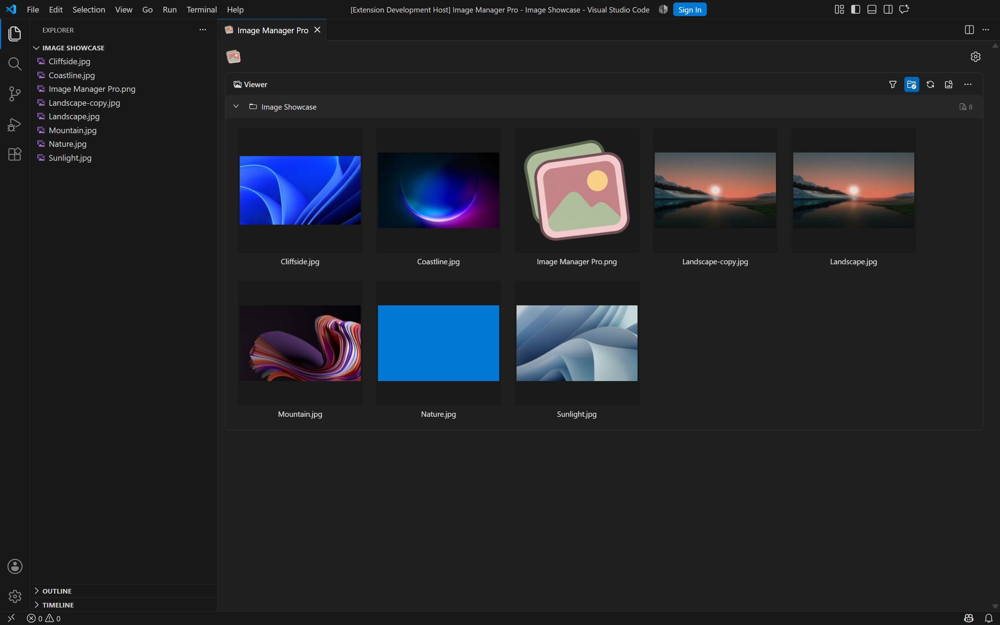
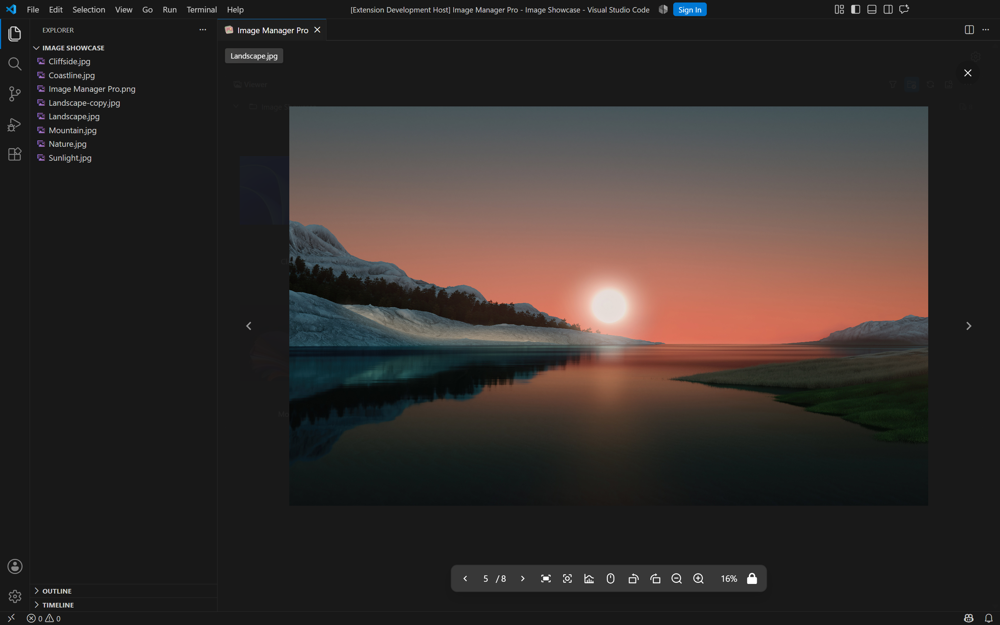
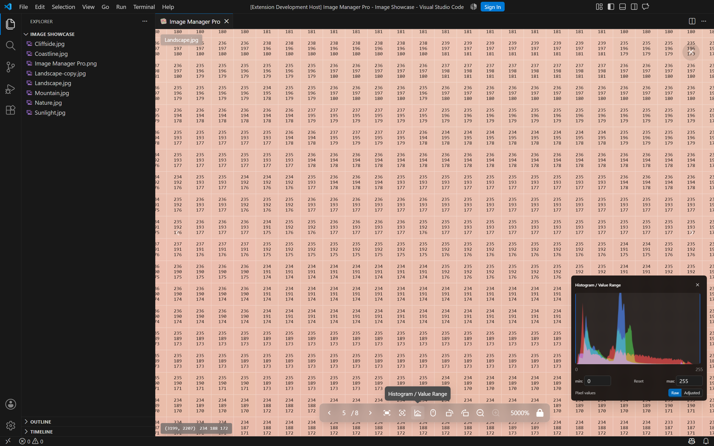
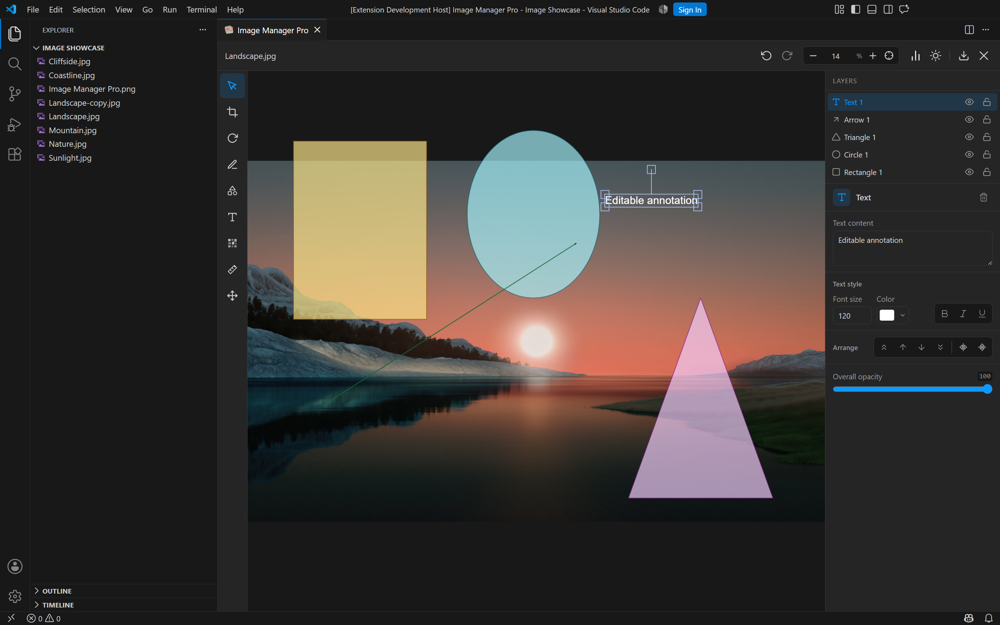
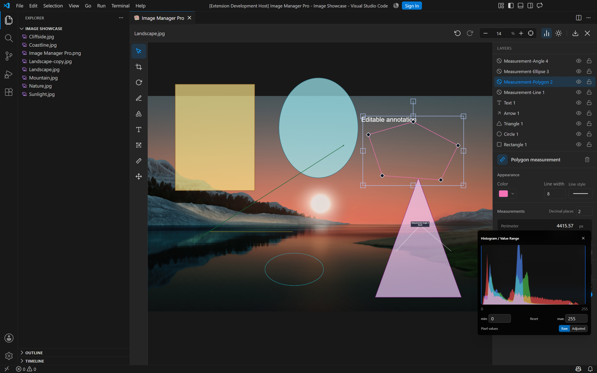
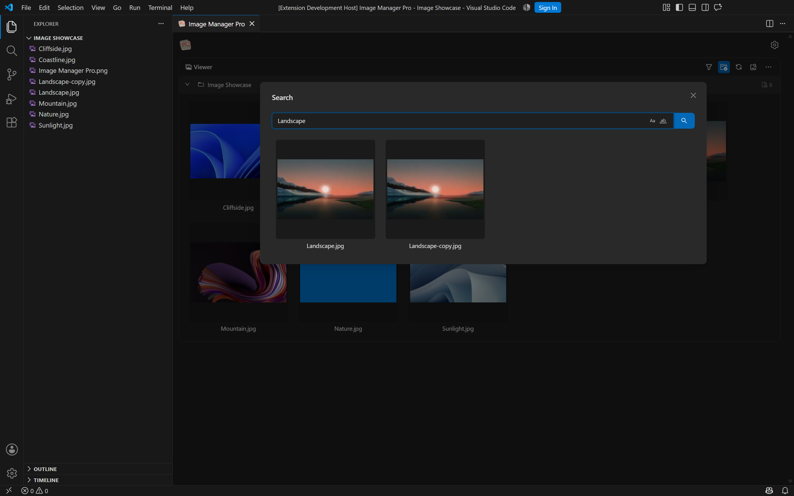
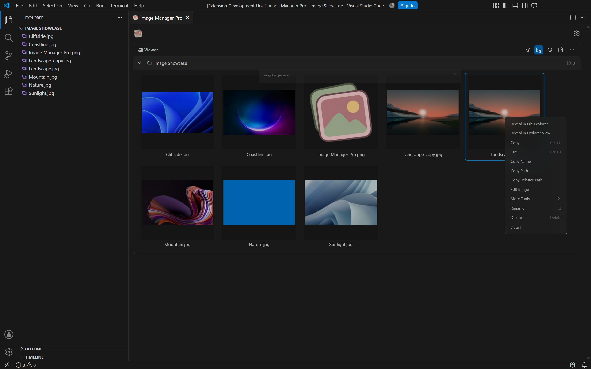
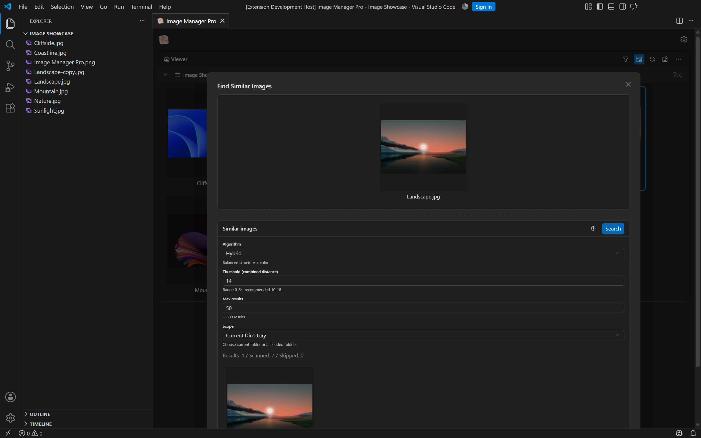

  

<h1 align="center">Image Manager Pro</h1>

在 VS Code 中完成图片浏览、像素检查、测量、标注和编辑。

[English](./README.md)

Image Manager Pro 把图片工作流放在代码旁边：打开工作区后，可以直接浏览文件夹中的图片，搜索文件名，查看像素和直方图，调整阈值，测量图像特征，添加可再次编辑的标注，并批量压缩或转换格式。

## 从工作区开始浏览

图片首页面向真实项目文件夹设计。你可以展开目录、搜索文件名、筛选和排序当前视图，一次选中多张图片，再从同一个右键菜单进入压缩、转换、重命名或相似图片查找。

- 按文件名搜索，支持区分大小写和全字匹配。
- 保留文件夹层级，浏览大量图片时也容易定位。
- 在 VS Code 或系统文件管理器中打开图片，也可以复制文件名和路径。
- 跟随 VS Code 的浅色或深色主题显示。

## 预览图片，滚轮用途由你决定

打开大图后，可以选择鼠标滚轮的用途。需要检查细节时，让滚轮负责缩放；需要连续浏览同一文件夹时，切换为左右翻页。两种模式都可以随时切换。

- 使用滚轮、工具栏按钮或倍率输入框缩放。
- 一键适应窗口、重新居中、旋转和翻转图片。
- 保留左右导航，快速查看前后图片。
- 不关闭当前预览，直接打开编辑器或直方图。
- 支持常见格式，也支持 TIFF、NPY 和可配置的原始二进制图像。

## 放大到 5000%，逐个检查像素

预览界面可以直接用作像素检查工具。将倍率设为 5000% 后，画面会按像素绘制网格，并在每个可读的像素格内显示灰度值或 RGB 数值。移动鼠标时，左下角会显示当前坐标和颜色值。

- 查看像素网格，以及单个像素的灰度值或 RGB 数值。
- 读取当前像素坐标和 RGBA 颜色值。
- 在原始值与调整后的显示值之间切换。
- 同时查看 RGB 或灰度直方图。
- 调整数值上下限，观察低对比度区域的细节变化。
- 将上下限设为同一数值，可快速预览二值化效果。

阈值调整是即时的可视化检查，不会自动生成分割结果或统计数据。它适合检查边缘、掩膜、截图、图标和科研图像中的局部细节。

## 编辑对象保留在图层中

编辑器适合需要反复修改的图片。除了裁剪、旋转、亮度和对比度调整，还可以添加文字、矩形、圆形、三角形、箭头、画笔和马赛克。

- 每个形状、箭头、文字和测量对象都会出现在图层列表中。
- 之后可以重新选中对象，移动、缩放、调整样式、隐藏或锁定。
- 对象彼此独立，不需要一开始就把标注压平成图片像素。
- 在属性面板中修改颜色、线宽、线型、字号、文字内容和排列方式。
- 使用撤销和重做反复调整，确认后再导出。

## 测量结果也可以继续编辑

编辑器支持直线、角度、多边形和椭圆测量。测量结果会作为对象保存，因此可以像其他图层一样再次选中和修改。

- 拖动节点修改测量位置；角度测量还可以调整弧线半径。
- 长度和周长以 `px` 显示，面积以 `px²` 显示，角度以度数显示。
- 设置小数位数，选择显示名称、数值或名称与数值。
- 分别调整测量线、节点和文字标注的颜色、字号、背景和透明度。
- 多边形和椭圆可以分别显示周长与面积。
- 完成后锁定对象，避免后续操作时误拖动。

## 在大工作区中快速找到图片

文件名搜索会在已加载的工作区中即时筛选结果。搜索结果可以直接进入预览、编辑器或右键菜单，适合图片数量较多的项目。

- 输入时即时筛选，并保留搜索历史。
- 文件名有规律时，可使用区分大小写或全字匹配。
- 使用方向键浏览历史搜索内容。

## 批量压缩与格式转换

选中图片后，可以统一设置目标格式、质量、压缩等级、输出倍率和输出目录，再一次处理整组文件。

- 根据已安装的编解码器处理 PNG、JPG、JPEG、WebP、GIF、TIFF、AVIF 和 HEIF。
- 选择保留原图，或将结果写入工具目录。
- 跳过已经压缩过的文件，减少重复处理。
- 对当前选择或整个目录执行同一套参数。

## 查找视觉相似图片

相似图片搜索会使用可配置的算法和阈值比较图片，并在同一个窗口中展示最接近的结果。

- 可比较当前目录，也可以比较所有已加载目录。
- 支持组合算法、pHash、dHash、aHash 和直方图算法。
- 调整阈值和最大结果数，平衡查找范围与误报数量。
- 找到结果后，可以继续使用预览和编辑功能。

## 不止支持 JPG 和 PNG

除常见图片格式外，还可以预览 TIFF、NPY 数组和可配置的原始二进制图像，并设置尺寸、通道、数据类型和字节序。像素、直方图和阈值工具可以继续使用，不会因为文件格式不同而中断检查流程。

## 语言与主题

在 `image-manager.appearance.language` 中选择 **English** 或 **简体中文**。编辑器工具、属性面板、颜色面板和测量标注会即时切换语言，同时保留当前画布、图层、自定义名称和已有文字。主界面还提供繁体中文、日语和德语，新版编辑器文案会使用英文回退。

支持浅色和深色 VS Code 主题。

## 开始使用

打开包含图片的工作区，在命令面板或文件夹右键菜单中运行 **Image Manager Pro**。

默认快捷键：Windows/Linux 使用 `Shift+Alt+J`，macOS 使用 `Cmd+Alt+J`。

部分图片操作使用 Sharp 及平台原生依赖。开启设置中的依赖安装后，扩展可以自动安装这些组件；实际可用格式取决于当前编解码器。

## 致谢

**本项目基于 hemengke1997（Minko）的 [Image Manager](https://github.com/hemengke1997/vscode-image-manager) 开发。** 原仓库的源码与设计构成了本扩展的基础，特别感谢原作者及所有贡献者的开源工作。

编辑器采用并改造了 ximing 的 [fabric-photo](https://github.com/ximing/fabric-photo) 代码，同时保留 Image Manager 原项目对 [vscode-image-viewer](https://github.com/ZhangJian1713/vscode-image-viewer) 和 [vscode-svgo](https://github.com/1000ch/vscode-svgo) 的致谢。

## 开源协议

项目代码采用 [MIT 协议](./LICENSE)。第三方组件保留各自的许可证，详见 [第三方声明](./THIRD_PARTY_NOTICES.md)。
