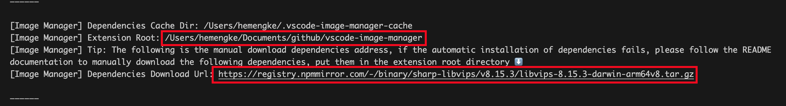

# FAQ

## Slow on First Launch?

The first time you open the extension, it may be slow because it needs to download necessary dependencies. This process depends on your network environment. Please be patient.

## Error: Dependency Installation Failed, Check Network

If you are in mainland China and have a poor network environment, please install dependencies manually

### Manually Install Dependencies

1. Open the command palette, type `Show Output Channel`, and select the Image Manager option.
2. Copy one of the install commands from the error notification and run it in the extension host terminal, then reload VS Code.
3. Use PowerShell or cmd on Windows. Use bash on Linux and WSL. WSL Remote runs the extension host on Linux, so it needs both the sharp and libvips archives.
4. If you download the archives yourself, put them in the Extension Root shown in the output and do not rename them.
5. Reload VS Code.

## Can I use the extension without installing dependencies?

If you do not need features such as image compression, format conversion, or finding similar images, you can choose not to install dependencies. Set `image-manager.core.installDependencies: false` in `settings.json`.

Fortunately, you can still use most of the extension's features.

## Why Did the File Size Increase After Compression?

- Adding "compressed" metadata during compression may cause small images to increase in size.
- You can adjust the compression error range by setting `image-manager.compression.errorRange`.

## Too Many Images, Feels Laggy?

- Configure `image-manager.appearance.reduceMotion: 'on'` to reduce animation effects.
- Open a specific directory by right-clicking the folder to reduce the number of rendered images.
