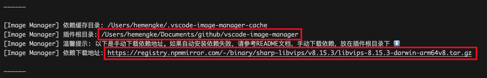

# 常见问题

## 第一次打开插件慢？

由于首次打开插件时需要下载必要的依赖，这个过程可能会比较慢，具体取决于您的网络环境。请耐心等待。

## 报错：依赖安装失败，请检查网络

如果您在中国大陆且网络环境不佳（你懂的），请手动安装依赖：

### 手动安装依赖

1. 打开命令面板，输入 `Show Output Channel`，选择 Image Manager 对应的选项。
2. 报错提示里有可以直接复制的命令。在扩展宿主的终端任选一条执行，然后重载窗口。
3. Windows 用 PowerShell 或 cmd。Linux 和 WSL 用 bash。WSL Remote 的扩展宿主是 Linux，需要同时下载 sharp 和 libvips。
4. 如果自己下载压缩包，请放到输出中的插件根目录，不要改文件名。
5. 重载 VS Code 即可。

## 不安装依赖能使用吗？

如果你不需要压缩图片、转换图片格式、查找相似图片等功能，你可以不安装依赖。在 `settings.json` 中设置 `image-manager.core.installDependencies: false` 即可。

幸运的是，你依然可以使用插件的大部分功能。

## 为什么压缩后文件反而变大了

- 由于压缩时添加了「是否已压缩」的元信息，可能导致小体积图片压缩后变大。
- 您可以设置 `image-manager.compression.errorRange` 来调整压缩误差范围。

## 图片太多，感觉卡顿？

- 可以配置 `image-manager.appearance.reduceMotion: 'on'` 来减少动画效果。
- 可以使用右键文件夹的方式打开指定的目录，从而减少渲染的图片数量。
